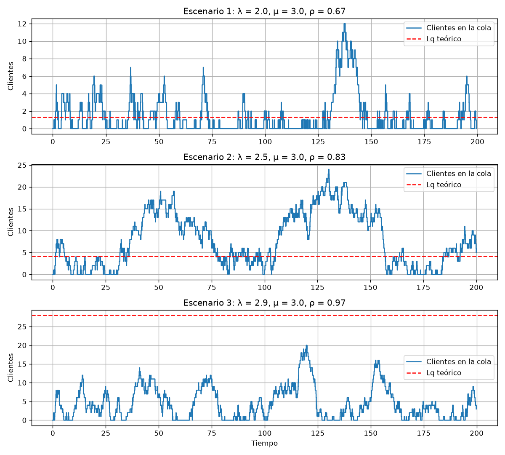
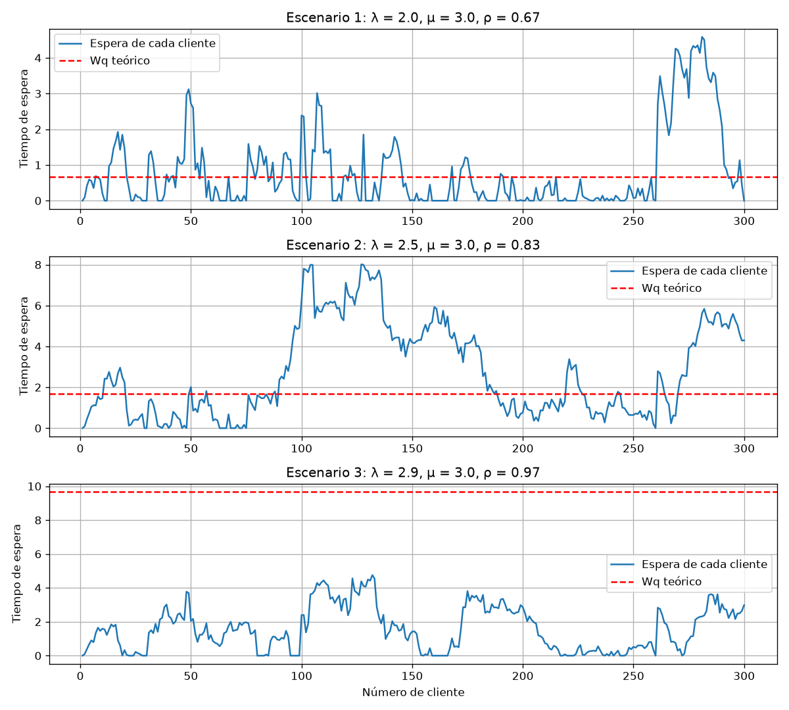
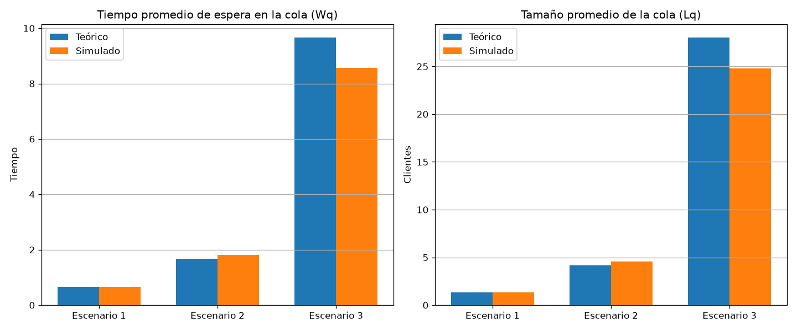

# Práctica 03 - Simulación de un sistema de líneas de espera M/M/1 con SimPy

| Campo | Detalle |
| --- | --- |
| Asignatura | Simulación |
| Ciclo | 5.º ciclo - FEIRNNR, Carrera de Computación |
| Práctica | Nro. 03 |
| Docente | José O. Guamán Q. |
| Integrantes | Jaime Landazuri, Richard Chamba, Cael Soto, Domenica Rojas |

## 1. Descripción del proyecto

Este proyecto simula una fila con **un solo servidor**, como una caja con una sola cajera.
Los clientes llegan al azar, esperan su turno y son atendidos uno por uno. El programa
calcula cuánto debería esperar la gente según la teoría y lo compara con lo que realmente
pasa al simular el sistema con SimPy.

**Propósito:** comprobar si los valores teóricos del modelo M/M/1 coinciden con los de la
simulación, y ver qué pasa con la cola cuando el servidor trabaja casi al límite.

**El modelo M/M/1:**

- Los clientes llegan al azar, en promedio `λ` por unidad de tiempo (distribución de Poisson).
- El servidor atiende en promedio `μ` clientes por unidad de tiempo (tiempos exponenciales).
- Hay un solo servidor y se atiende en orden de llegada (FIFO).
- Para que la cola no crezca sin parar debe cumplirse `λ < μ`.

| Medida | Qué significa | Fórmula |
| --- | --- | --- |
| ρ | Qué tan ocupado está el servidor | `λ / μ` |
| L | Clientes en el sistema (cola + el que se atiende) | `λ / (μ - λ)` |
| Lq | Clientes en la cola | `λ² / (μ (μ - λ))` |
| W | Tiempo que un cliente pasa en el sistema | `1 / (μ - λ)` |
| Wq | Tiempo que un cliente espera en la cola | `λ / (μ (μ - λ))` |

> En el texto de la guía aparece `ρ = μ / λ`, pero el pseudocódigo y la condición `λ < μ`
> indican que lo correcto es `ρ = λ / μ`, que es lo que usa el programa.

**Escenarios de la guía** (con sus valores teóricos):

| Escenario | λ | μ | Condición | ρ | L | Lq | W | Wq |
| --- | --- | --- | --- | --- | --- | --- | --- | --- |
| 1 | 2.0 | 3.0 | Sistema estable | 0.667 | 2.000 | 1.333 | 1.000 | 0.667 |
| 2 | 2.5 | 3.0 | Mayor utilización | 0.833 | 5.000 | 4.167 | 2.000 | 1.667 |
| 3 | 2.9 | 3.0 | Cerca de saturación | 0.967 | 29.000 | 28.033 | 10.000 | 9.667 |

## 2. Tecnologías utilizadas

- Python 3
- SimPy (la simulación de la fila)
- NumPy y Matplotlib (gráficas)
- Organización en modelo, vista y controlador (MVC)

## 3. Instalación

En Ubuntu:

```bash
sudo apt update
sudo apt install python3 python3-venv python3-pip    # solo la primera vez
cd simulacion_mm1
python3 -m venv venv
source venv/bin/activate
pip install -r requirements.txt
```

## 4. Uso

```bash
python3 main.py
```

El programa simula los escenarios uno por uno y muestra en la terminal dos tablas:

- **Valores teóricos:** ρ, L, Lq, W y Wq de cada escenario.
- **Teoría vs simulación:** tiempo de espera (Wq) y tamaño de la cola (Lq), teóricos y
  simulados, con la diferencia en porcentaje.

Cada tabla se imprime con su leyenda arriba: el significado de cada variable entre
paréntesis, por ejemplo `λ (tasa de llegada de clientes)`, para que la salida se
entienda sin tener que abrir el informe.

Después abre tres gráficas (se cierra cada ventana para ver la siguiente). Las imágenes
quedan guardadas en la carpeta `graficas/`.

Si no hay entorno gráfico (por ejemplo al ejecutar por SSH, en un servidor o con
`MPLBACKEND=Agg`), no se abre ninguna ventana y las imágenes quedan igual en `graficas/`.

Si en algún escenario `λ` es mayor o igual que `μ`, el programa avisa que el sistema no
es estable, no lo simula y sigue con los demás.

## 5. Configuración

**Escenarios:** están en `modelo/escenarios.py`, cada uno en su propio bloque. Para cambiar
`λ` o `μ` de un escenario se editan sus números. Para agregar uno nuevo se copia un bloque
y se añade a la lista `ESCENARIOS`.

**Simulación:** están al inicio de `controlador/controlador.py`.

| Variable | Qué hace | Valor |
| --- | --- | --- |
| `TIEMPO_SIMULACION` | Cuánto tiempo se simula cada vez | 5000 |
| `REPETICIONES` | Veces que se repite cada escenario, con distinta semilla | 10 |
| `SEMILLA` | Número base para que los resultados se puedan repetir | 42 |

Se repite cada escenario porque una sola corrida cambia mucho por el azar, sobre todo
cuando `λ` está cerca de `μ`. Si se baja mucho el tiempo de simulación, las diferencias
con la teoría serán mayores.

## 6. Estructura del proyecto

```text
simulacion_mm1/
├── main.py                  # punto de entrada
├── requirements.txt         # librerías necesarias
├── modelo/
│   ├── escenarios.py        # los escenarios, cada uno definido aparte
│   ├── teoria.py            # fórmulas teóricas (ρ, L, Lq, W, Wq)
│   └── simulacion.py        # la fila M/M/1 con SimPy
├── vista/
│   ├── tabla.py             # tablas en la terminal
│   └── graficas.py          # las tres gráficas
├── controlador/
│   └── controlador.py       # recorre los escenarios y une modelo y vista
├── graficas/                # imágenes generadas al ejecutar
├── reports/                 # el informe (LaTeX, PDF, figuras y bibliografía)
└── docs/                    # guía de la práctica y plantilla institucional
```

- **modelo:** los datos y los cálculos. No imprime ni dibuja nada.
- **vista:** muestra los resultados (tablas y gráficas). No calcula nada.
- **controlador:** pide los cálculos al modelo y se los pasa a la vista.

## 7. Información adicional

### Funcionalidades

- Simulación de llegadas y atención con un solo servidor usando SimPy.
- Valores teóricos de ρ, L, Lq, W y Wq para cada escenario.
- Tiempo promedio de espera y tamaño promedio de la cola obtenidos de la simulación.
- Tabla que compara la teoría con la simulación.
- Aviso cuando un escenario no es estable.

### Gráficas

**Clientes en la cola a lo largo del tiempo** (primeras 200 unidades de tiempo, una por
escenario, con la línea roja del valor teórico Lq):



**Tiempo de espera de cada cliente** (primeros 300 clientes, con la línea roja del valor
teórico Wq):



**Teoría vs simulación** (barras de Wq y Lq por escenario):



### Informe

El informe en LaTeX y su PDF están en la carpeta `reports/`: `ape3_mm1.tex` y
`ape3_mm1.pdf`. Los números de sus tablas salen de la corrida de `python3 main.py`.

El informe es completo: metodología, resultados, análisis de resultados, respuestas
a las preguntas de control, conclusiones y la declaración de uso de IA.

### Uso de IA

Se usó IA como apoyo para organizar el proyecto en modelo, vista y controlador, escribir
la primera versión del código y redactar este README.

La declaración completa (herramientas, prompt representativo y alcance) está en el
informe, sección *Declaración de uso de Inteligencia Artificial*
(`reports/ape3_mm1.pdf`).
